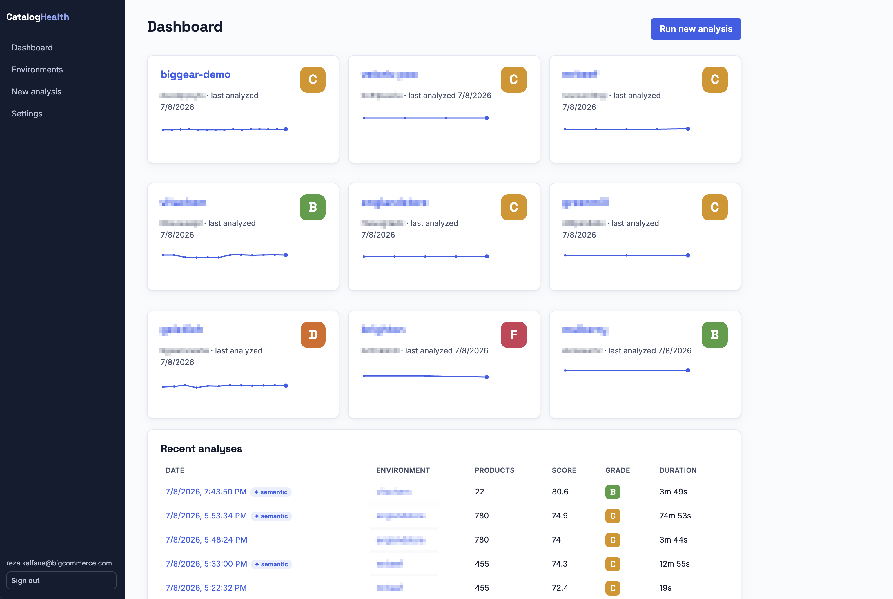

# BigCommerce Catalog Health

Internal tool for CSMs and merchandising strategists: analyze a BigCommerce
store's catalog health and AI-readiness, track it over time, and get a
prioritized fix list weighted by traffic and sales.



Monorepo with three parts:

```
packages/core   Shared engine: BigCommerce v3 Catalog API client, scoring
                across 5 dimensions, summaries, CSV export, and controlled
                product update helpers for reviewed AI suggestions.
packages/cli    yargs CLI — run an analysis from the terminal, get a console
                report + CSVs.
apps/web        Next.js app — manage environments (stores), run analyses,
                browse dashboards and per-environment history.
```

## Requirements

- Node.js >= 20 (uses native `fetch` and the AI SDK provider adapters)
- A BigCommerce API token per store. **Products: read-only** scope is enough
  to run catalog analyses. **Products: modify** scope is required only when
  operators use AI push actions to update product fields, categories, related
  products, custom fields, or image alt text. Optional: a **Channel settings:
  read-only** scope lets reports show channel names instead of tree ids.
- Optional, for semantic scoring: an Anthropic or OpenAI API key, or a
  local [Ollama](https://ollama.com) install (free) — configured under
  **Settings** in the web app.

## Setup

```bash
npm install
```

## CLI

```bash
# Instant demo with a synthetic 120-product catalog:
npm run cli -- analyze --demo

# Against a real store:
npm run cli -- analyze --store-hash abc123 --token $BC_AUTH_TOKEN

# Options: --out <dir> (CSV output, default health_report/), --json
```

Outputs a console report plus three CSVs: per-product scores, category
rollups, and a top-50 fix list.

## Web app

```bash
npm run dev
# open http://localhost:3000
```

- **Settings → Environments** — add / edit / remove BigCommerce stores (name, store
  hash, access token, and scoring profile). Tokens are write-only in the UI:
  the API never sends them back to the browser. Read-only product tokens can
  run analyses; product-modify tokens are needed for AI push actions.
- **New analysis** — pick an environment and run; or run a demo analysis with
  no credentials to see the dashboards populated. Analyses run asynchronously:
  you land on a live analysis page (progress bar + sections filling in as the
  run advances) and can navigate away and come back at any time. When semantic
  scoring is enabled, choose any ready saved model; the default is preselected
  and the exact configuration/provider/model is captured with the report.
- **Dashboard / environment pages** — latest grade, score sparkline over
  time, dimension breakdown, most common issues, weakest categories, and the
  impact-weighted top-fix list. Top fixes support product/SKU search, grade
  filtering, sortable columns, and filtered/sorted CSV export; analysis pages
  show up to 100 matches while environment overviews remain capped at 15.
  Environment analysis history includes the profile captured by each run and
  compact actions for the PDF report, complete product CSV, and confirmed
  deletion. A full **Delete analysis** button is also available from the
  report itself. The Dashboard Recent analyses table provides the same blue
  PDF, green full-product CSV, and red confirmed-delete actions.
- **Statistics** — account-wide rollups from the latest live-catalog analysis
  per environment: headline counts, weighted account score, grade distribution,
  dimension averages, AI/semantic coverage, commercial exposure on D/F
  products, environment leaderboard, top issues by count and impact,
  highest-impact products, weakest categories, and scoring-profile usage. The
  same account summary can be exported as a paginated PDF.
- **Analysis comparison** — from a completed analysis, choose any of the ten
  immediately preceding runs from the same environment. The picker shows each
  run's date, product count, score, grade, duration, and semantic-scoring tag.
  Comparisons include score/grade/product-count deltas, dimension shifts,
  issue and category changes, and sortable product-by-product resolved/new
  issue details. Export the current filtered/sorted product changes as CSV or
  download the complete comparison summary as a paginated PDF.
- **Profile recalculation** — replay any completed analysis under another
  static profile using the exact product facts and semantic verdicts captured
  by the original run. Recalculation makes no BigCommerce or LLM calls, leaves
  the environment default and source analysis untouched, and saves a linked
  derived analysis with a one-click comparison back to its source.
  Derived reports remain visible in history but do not replace the latest
  live-catalog result or alter environment score trends.
- **PDF report export** — download a completed analysis as a polished A4
  report with headline statistics, grade and dimension charts, common issues,
  weakest categories, and the ten highest-impact fixes. Filenames include the
  environment, analysis timestamp (UTC), and a short analysis id so repeated
  runs never overwrite one another. All PDF exports preserve accented
  Western-European catalog text such as product, category, and environment
  names while removing unsafe control characters.
- **Product table & drill-down** — every analysis stores its full per-product
  results: browse them with filters (search, grade, issue, category, sort),
  export the filtered/sorted list as an Excel-friendly CSV, and open any
  product for its dimension scores, issues with fix hints, traffic and impact.
  Each product detail can be exported as a comprehensive paginated PDF with
  product facts, scoring evidence, semantic findings, and the complete saved AI
  Analysis—including safely retrievable reviewed-image thumbnails—when one is
  available. For live BigCommerce analyses, a product detail can also refresh
  that single product from BigCommerce, re-score it under the analysis's
  captured scoring profile, re-run that product's semantic verdict when the
  original semantic model configuration is still available, and recompute the
  analysis-level summary so global score, grade, distributions, issues,
  category rollups, and top fixes stay consistent. Unchanged product rows keep
  their original captured product facts, including thumbnail URLs, while the
  refreshed product receives the current BigCommerce facts.
- **On-demand product AI Analysis** — from a product drill-down, use the LLM
  selected beside the action to generate a saved, merchant-ready review: prioritized
  fixes, revised title and descriptions, derived catalog fields, category and
  merchandising placement, feed/SEO values, conversion opportunities, data
  risks, and merchant follow-up questions. Vision-capable models also review up
  to five BigCommerce-hosted images for quality, role, missing shots, hero
  selection, and accessible alt text; unsupported models retry text-only.
  The review can also recommend up to five verified products from the analyzed
  catalog, using title, description, taxonomy, imagery, custom fields, options,
  commercial signals, and other stored product facts. Recommendation cards show
  the current thumbnail, title, categories, price, SKU, product ID, and a
  product-specific reason; the same section is retained in product PDF exports.
  While it runs, the product page streams the actual server stage—from loading
  catalog data through image preparation, generation, validation, and saving.
  The saved review and product PDF retain the configuration name and underlying
  provider/model used, even if that configuration is later edited or removed.
  When the product has a semantic review, the AI prompt includes each semantic
  verdict and reason so title and description suggestions can explicitly close
  gaps around what the product is, who it is for, and what it is made of.
  Reviewed suggestions that map cleanly to BigCommerce product APIs can be
  pushed back from the product page: title, HTML description, supported core
  fields, custom fields, existing categories, SEO/search values, image alt text,
  and catalog-grounded product recommendations as related products. Section-level
  bulk actions are available for suggested fields, categories, SEO, related
  product recommendations, and image alt text; already-applied/no-effect changes
  are hidden or skipped where the current product state can be verified.
- **Settings → Models** — add, edit, remove, test, and name multiple Anthropic, OpenAI,
  or local Ollama model configurations and choose one default. The default is
  merely the initial choice: semantic and product AI actions can select another
  ready model for each run. API keys remain encrypted at rest and write-only in
  the UI (`ANTHROPIC_API_KEY` / `OPENAI_API_KEY` environment fallbacks remain
  supported). Existing single-model settings are imported automatically.
- **Settings → Profiles** — inspect the four protected built-in scoring
  profiles or add, edit, copy, and remove account-specific profiles with custom
  dimension weights, semantic weight, and catalog thresholds. Built-in and
  custom profiles can both be copied into a new editable custom profile. Custom
  profiles are available to environments, new analyses, and stored-fact
  recalculations. Each edit creates a new profile revision for comparison
  metadata; deleting a profile reassigns its environments to Balanced while
  completed analyses keep their immutable profile snapshot.

Model and scoring-profile persistence have dedicated integration tests:

```bash
npm run test_llm_models
npm run test_scoring_profiles
```

## Product AI Analysis

Product AI Analysis is an on-demand, saved review generated from a product
detail page. It uses the selected model configuration for that run and stores
the configuration name, provider, raw model id, source mode, image-analysis
flag, generated timestamp, and structured result. The latest saved review is
shown again when the product page is reopened and is included in the product
PDF export.

During generation, the product page streams the current server stage so the
operator can see whether the workflow is loading catalog context, preparing
images, generating the review, validating structured output, or saving the
result. Vision-capable models receive up to five safely retrievable
BigCommerce-hosted images; models that reject image input retry automatically
with product data only.

| Section | What it contains | Intended use |
|---|---|---|
| AI metadata | Saved configuration name, provider, model id, review source, image-analysis status, and generated time. | Audit which model produced the recommendation and whether images were inspected. |
| Executive summary | Short overall assessment plus a confidence badge. | Quickly understand the product's biggest catalog and merchandising opportunities. |
| Priority actions | Ranked action cards with priority, recommendation, evidence, impact, effort, and verification flag. | Decide what to fix first and whether a human needs to confirm the claim. |
| Title | Current-title assessment, suggested title, alternatives, and rationale. | Improve titles while staying inside the scoring profile's length and clarity expectations. |
| Description | Assessment, short description, rewritten long description, selling points, and missing information. | Produce merchant-ready copy and identify facts that cannot be safely inferred. |
| Suggested fields | Derived custom, system, or feed fields with suggested value, type, confidence, evidence, verification marker, per-row push buttons, and an "Add all fields" bulk action for supported fields. | Fill catalog attributes only when the source data supports the recommendation. |
| Placement & merchandising | Suggested categories, merchandising collections, and cross-sell ideas. Existing BigCommerce categories can be pushed individually or with "Add all categories"; no-effect category pushes are hidden when the product is already assigned. | Improve taxonomy and storefront merchandising using product context and existing catalog structure. |
| Feed, SEO & discovery | Google product category, product type, SEO title, SEO description, and search terms, with push actions for BigCommerce SEO/search fields. | Prepare cleaner feed values and search/discovery copy. |
| Product recommendations | Up to five catalog-grounded complementary, substitute, or adjacent products with thumbnail, title, categories, price, SKU, product id, reason, and related-product push actions. | Support cross-sell, upsell, bundling, and related-product merchandising from the analyzed catalog. |
| Feed-ready attributes | Feed-specific attributes with suggested value, confidence, evidence, and verification marker. | Improve marketplace and AI-agent feed readiness without inventing unsupported values. |
| Image review | Summary, recommended hero image, per-image thumbnail, role, quality score, observations, suggested alt text with per-image and "Add all alt text" push actions, missing shots, and image limitations. | Assess image quality, coverage, accessibility, and whether more photography is needed. |
| Conversion opportunities | Opportunities and rationale tied to merchandising or product-page conversion. | Identify non-scoring improvements likely to help shoppers evaluate or buy the product. |
| Data-quality risks | Risk, supporting evidence, and recommended check. | Surface places where the catalog data may mislead the model, merchant, or shopper. |
| Questions for the merchant | Follow-up questions for missing or ambiguous facts. | Collect inputs that should not be guessed by the model. |
| Checks and limitations | Identifier warnings plus model-stated limitations. | Keep generated recommendations bounded by what was actually known at review time. |

The AI review treats catalog copy as untrusted input and asks the model to
ground recommendations in stored product facts, scoring issues, category
context, commercial signals, custom fields, options, variants, and the
catalog-recommendation shortlist. Suggested values still require merchant
review before publishing, especially fields marked for verification.

AI push actions are explicit operator-triggered writes to the source
BigCommerce product. They require the environment token to have Products:
modify scope. The server re-fetches the live product before writing, rejects
no-effect pushes, records pushed suggestion ids on the saved AI review, and
normalizes rewritten descriptions to a single-line `<div>...</div>` HTML
string before updating BigCommerce. Product recommendations are pushed as
explicit `related_products` entries while preserving existing related product
ids.

### PDF export smoke test

```bash
npm run test_pdf_export
```

This generates a representative two-page report, validates its PDF structure,
and leaves the ignored artifact at `tmp/pdfs/catalog-health-test.pdf` for
optional visual inspection.

Comparison PDFs have their own representative smoke test:

```bash
npm run test_comparison_pdf_export
```

It generates and validates a multi-page comparison report at
`tmp/pdfs/catalog-health-comparison-test.pdf`.

Product detail PDFs have a comprehensive representative smoke test:

```bash
npm run test_product_pdf_export
```

It validates both AI-enriched and no-AI reports and leaves the rendered source
PDF at `tmp/pdfs/catalog-health-product-test.pdf` for visual inspection.

PDF generation is split by report type under `apps/web/lib/report-pdf/`:

| File | Responsibility |
|------|----------------|
| `common.js` | Shared PDF renderer, formatting helpers, charts, and scoring metadata tables. |
| `analysis.js` | Completed analysis PDF export. |
| `comparison.js` | Analysis comparison PDF export. |
| `product.js` | Product detail PDF export, including saved AI Analysis sections and thumbnails. |
| `statistics.js` | Account statistics PDF export. |

`apps/web/lib/report-pdf.js` remains a compatibility barrel so existing API
routes can keep importing `createReportPdf`, `createComparisonReportPdf`,
`createProductReportPdf`, and `createStatisticsReportPdf` from the original
module path.

The product AI workflow has an integration test for structured output,
streamed stages, owner-scoped persistence, image binding, table indicators,
and deletion cascade:

```bash
npm run test_product_ai_analysis
```

## Scoring profiles

Each environment selects a static scoring profile when it is created or
edited. The profile changes both dimension weights and rule thresholds; every
analysis snapshots the exact configuration it used, so later profile changes
do not rewrite history. The selected profile appears below environment names
across the dashboard and analysis views, and each row in an environment's
Analysis history table shows the profile used for that specific run.

| Profile | Emphasis | Dimension weights | Semantic weight | Key thresholds |
|---|---|---|---|---|
| Balanced | Even coverage across content, structure, taxonomy, commerce hygiene, and feeds; this is the default for existing environments and demo runs. | Content 25%, structure 25%, taxonomy 15%, hygiene 20%, feed 15% | 15% | Description: 200 min / 500 good chars; images: 2 min; categories per channel tree: 5 max; title: 10-150 chars |
| Content Quality | Richer descriptions, stronger titles, and deeper image coverage. | Content 40%, structure 20%, taxonomy 10%, hygiene 10%, feed 20% | 15% | Description: 300 min / 700 good chars; images: 3 min; categories per channel tree: 4 max; title: 15-120 chars |
| Marketplace Readiness | Complete attributes and dependable feed data for external channels. | Content 20%, structure 25%, taxonomy 10%, hygiene 15%, feed 30% | 15% | Description: 250 min / 600 good chars; images: 3 min; categories per channel tree: 5 max; title: 12-150 chars |
| Catalog Governance | Consistent attributes and disciplined taxonomy. | Content 15%, structure 30%, taxonomy 30%, hygiene 15%, feed 10% | 15% | Description: 200 min / 500 good chars; images: 2 min; categories per channel tree: 3 max; title: 10-120 chars |

The current static definitions live in `packages/core/src/profiles.js`. Their
shape is designed to support future user-created profiles, custom weights, and
per-rule enable/disable controls without changing stored analysis snapshots.

On a completed analysis, **Recalculate** offers every profile other than the
one already used. The scoring engine rebuilds all product scores, issues,
grades, impact rankings, dimension averages, category rollups, and headline
statistics from the stored facts. If semantic scoring was applied, its saved
per-criterion verdicts are reused rather than sent to a model again. Analyses
that predate per-product scoring facts cannot be recalculated.

The rollback-only integration test exercises the complete replay and SQLite
lineage flow without leaving fixture data behind:

```bash
npm run test_analysis_recalculation
```

### Balanced profile dimensions

| Dimension | Weight | What it checks |
|---|---|---|
| content | 25% | description depth, image count, alt text, title quality, brand |
| structure | 25% | custom fields **vs category peers**, GTIN/UPC/MPN, variant completeness |
| taxonomy | 15% | orphaned products, missing categories, over-categorization (judged per channel tree on multi-storefront stores) |
| hygiene | 20% | zero prices, sale >= regular price, missing weight, visible-but-OOS |
| feed | 15% | minimum field set for Google Shopping / AI-agent feeds |

Impact score = `(100 - score) x log(1 + views + 5*sales)` using `view_count`
and `total_sold` from the product record — no Orders scope needed.

**Optional 6th dimension — semantic (15%)**: an LLM judges whether each
description answers *what is it, who's it for, what's it made of*
(`yes`/`partial`/`no` per criterion; what-is-it counts double). When enabled,
the five heuristic dimensions scale down proportionally to make room. Failing
criteria add `desc_*` issues to the report. Products without a description
score 0 without spending tokens; demo analyses use a free simulated judge.
Configure the provider/model under **Settings**; enable per-run on the New
Analysis page. If the pass fails mid-run the analysis degrades gracefully to
the 5-dimension report with a warning.

OpenAI semantic judging is throttled proactively to avoid request-per-minute
bursts: by default it runs one chunk at a time with at least 500ms between
requests, and still retries transient 429 rate-limit responses. Override with
`OPENAI_JUDGE_CONCURRENCY` and `OPENAI_JUDGE_MIN_DELAY_MS` if your account has
higher limits.

Profile weights and thresholds live in `packages/core/src/profiles.js`; the
scoring engine is in `packages/core/src/scoring.js` and the judge in
`packages/core/src/semantic.js`.

Every new analysis stores a scoring metadata snapshot: engine and profile
versions, dimension weights, thresholds, semantic weight, prompt version, and
the provider/model actually used when semantic scores were applied. Analysis
pages and PDF exports show the complete snapshot as well as a compact header
summary. Comparisons in both the app and PDF exports display previous and
current settings side by side, highlight changed values, and warn when formula
differences—or missing metadata on a legacy run—mean a score delta may not be
entirely attributable to catalog changes.

## Issues detected

Every product is flagged with named issues; they drive the "most common
issues" table and the per-product drill-down (where each shows a fix hint).
The full set, by dimension:

| Dimension | Issue | What it flags |
|---|---|---|
| content | Missing description | No description at all. |
| content | Thin description | Description below the selected profile's minimum length. |
| content | No images | The product has no images. |
| content | Not enough images | Image count below the selected profile's target. |
| content | Missing image alt text | Fewer than half the images have alt text. |
| content | Weak title | Title too short, too long, or SKU-like (not human-readable). |
| content | ALL-CAPS title | Title is written in all capitals. |
| content | No brand assigned | No brand set on the product. |
| structure | Fewer attributes than peers | Under half the custom fields its category peers typically have. |
| structure | No custom fields | No structured attributes, and no peer baseline to compare against. |
| structure | No GTIN / UPC / MPN | No product identifier of any kind. |
| structure | Incomplete variant options | Some variants are missing option values. |
| taxonomy | Not in any category | The product is orphaned — assigned to no category. |
| taxonomy | Assigned to a missing category | References a category id that no longer exists. |
| taxonomy | In too many categories | Exceeds the selected profile's limit **within a single channel tree**. |
| hygiene | Zero price | Price is 0. |
| hygiene | Sale price ≥ regular price | The "sale" price isn't actually lower. |
| hygiene | Missing weight | No shipping weight set. |
| hygiene | Visible but out of stock | Visible, inventory-tracked, and at zero stock. |
| feed | Feed: no image | Fails the Google/AI-feed image requirement. |
| feed | Feed: description too short | Under ~50 characters — fails the feed requirement. |
| feed | Feed: no brand | Missing the feed's required brand attribute. |
| feed | Feed: no identifier | Missing the feed's required GTIN/UPC/MPN. |
| feed | Feed: no price | Missing a non-zero price for the feed. |
| semantic | Doesn't say what it is | LLM judged the description doesn't make clear what the product is. |
| semantic | Doesn't say who it's for | LLM judged it doesn't state the audience or use case. |
| semantic | Lacks materials / specs | LLM judged it doesn't state materials, ingredients, or specs. |

The three `semantic` issues appear only when semantic scoring is enabled.
Labels and fix hints for each live in `apps/web/components/issue-info.js`.

## Data & security notes

- Data persists to `data/catalog-health.sqlite` (better-sqlite3, WAL mode).
  `apps/web/lib/db.js` is the only data-access surface — every page and API
  route goes through it — and `apps/web/lib/sqlite.js` owns the connection,
  schema, and migrations (append a block to `MIGRATIONS`; versions tracked
  via `PRAGMA user_version`). Tables: `environments`, `analyses`,
  `analysis_products` (per-product results, FK-cascaded),
  `product_ai_analyses` (latest optional generated review), and `settings`.
  Recalculated analyses retain a nullable self-reference to their source;
  deleting the source clears that link without deleting the derived report.
  Deleting an analysis cascades to its stored per-product rows, while analyses
  still in progress are protected from deletion.
- A leftover `data/db.json` from the previous JSON-file store is imported
  automatically on first run and renamed to `db.json.migrated`.
- **Secrets are encrypted at rest** (AES-256-GCM) when `APP_ENCRYPTION_KEY`
  is set: store access tokens and LLM API keys are ciphertext in the DB, and
  the key lives only in the environment (an untracked `apps/web/.env.local`
  locally; a secrets manager in production) — never in `data/` or the repo.
  Copy `apps/web/.env.example` to `.env.local` and generate a key with
  `node -e "console.log(require('crypto').randomBytes(32).toString('base64'))"`.
  On first run with a key set, any existing plaintext secrets are migrated to
  ciphertext and the freed pages are vacuumed. Without the key the app still
  runs but stores secrets in plaintext (a warning path). **Losing the key**
  means re-entering tokens under Environments / Settings.
- `data/` is still **gitignored** — the DB holds encrypted secrets, but treat
  it as sensitive. Before any shared deployment, add authentication to the
  app and move the key to a managed secrets store (per company policy, start
  with a GRC review).
- **Authentication & multi-tenancy** (Auth.js): the app requires sign-in and
  scopes environments, analyses, and settings per user — each account sees
  only its own data. Google SSO (restricted to the company domain) is used
  when `AUTH_GOOGLE_ID`/`AUTH_GOOGLE_SECRET` are set; in non-production a
  **dev login** (sign in as any email) is available for local testing. The
  first account to sign in adopts any pre-auth data. See the auth vars in
  `apps/web/.env.example`.
- Product AI Analysis treats catalog copy as untrusted prompt data and asks
  the model not to invent product claims or identifiers. It writes changes back
  to BigCommerce only when an operator clicks an AI push action and the
  environment token has Products: modify scope. Server-side image retrieval
  accepts only HTTPS images on BigCommerce CDN hosts, with count, timeout,
  media-type, and size limits.
- Company policy: no PII into Claude when developing against real catalogs,
  and any deployment must start with a GRC review — no personal
  Vercel/Netlify accounts.

## Roadmap ideas

- [x] Semantic scoring pass (LLM judges whether descriptions answer
      "what is it, who's it for, what's it made of") — Anthropic or Ollama,
      configured in Settings. CLI `--semantic` flag still to do.
- [x] Async analysis jobs with progress
      (in-process runner — jobs don't survive a server restart; they're marked
      failed. A real queue is only needed if this outgrows one process)
- [x] Per-product drill-down page and full product table with filters
      (`/analyses/[id]/products`; per-product rows persist with each new
      analysis — older analyses predating this have summary only)
- [x] CSV export from the web app (filtered/sorted product list)
- [x] PDF export from the web app
- [x] Compare two analyses (what improved / regressed)
- [x] Static scoring profiles with per-environment selection, profile-aware
      thresholds and weights, immutable analysis metadata, and PDF/comparison
      visibility
- [x] Recalculate an existing analysis with another profile using its stored
      scoring facts, preserve the original analysis, and link the derived run
      back to its source for one-click comparison
- [x] Delete completed analyses from history or the report, cascade stored
      product rows, preserve derived reports, and protect active runs
- [x] Compact PDF, full-product CSV, and confirmed-delete actions in both the
      Dashboard Recent analyses and environment Analysis history tables
- [x] On-demand, persisted product AI Analysis with provider-aware structured
      recommendations, live-product/snapshot fallback, copy-ready fields, and
      safe multimodal image review where the selected model supports it
- [x] Comprehensive product-detail PDF export with scoring evidence, semantic
      findings, optional saved AI recommendations, and reviewed-image previews
- [x] Reviewed AI push actions for product fields, custom fields, categories,
      SEO/search values, related products, and image alt text, including
      section-level bulk push controls
- [x] Refresh a single product from BigCommerce inside a completed live
      analysis and recompute the analysis summary from the updated product row
- [x] Swap JSON store for SQLite (better-sqlite3, WAL, versioned migrations,
      auto-import of the legacy db.json)
- [x] Auth (Google SSO + dev login) and per-user multi-tenancy
      (production Google OAuth client + GRC review still needed before deploy)
